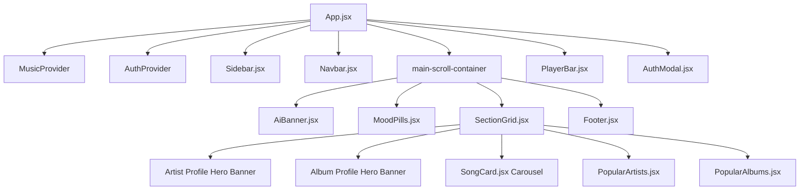

# 🎵 AI Mood Music - Frontend Developer & Fresher Guide

Ek modern, responsive, Spotify-grade music streaming application jo React, Vite, Tailwind CSS aur JioSaavn Music API par bani hui hai.

---

## 📂 1. Project Folder Structure & File Purpose

Yahan har folder aur file ka kaam beginner/fresher level par explain kiya gaya hai:

```text
AI mood Music/
├── public/                     # Static Assets (Images, Icons)
│   ├── artists/                # 12 Legendary Indian Singers ke Local HD Portraits (.jpg)
│   └── vite.svg                # Favicon
│
├── src/
│   ├── components/             # Reusable UI Components
│   │   ├── auth/
│   │   │   └── AuthModal.jsx   # Login & Signup Popup Dialog with form validation
│   │   ├── common/
│   │   │   └── Footer.jsx      # Bottom page footer & copyright
│   │   ├── layout/
│   │   │   ├── Navbar.jsx      # Top Header with Live Search & User Profile dropdown
│   │   │   ├── Sidebar.jsx     # Left navigation (Home, Moods, Liked Songs, Playlists)
│   │   │   └── PlayerBar.jsx   # Fixed Bottom Audio Controller (Play, Seek, Volume, Shuffle)
│   │   └── music/
│   │       ├── AiBanner.jsx    # AI Prompt Banner (Shows AI-generated mood & playlist)
│   │       ├── MoodPills.jsx   # Quick Mood Filter Tabs (Chill, Energy, Sad, Romantic, etc.)
│   │       ├── SectionGrid.jsx # Main Dashboard View Controller (Tracks, Artist & Album Hero Banners)
│   │       ├── SongCard.jsx    # Individual Song Card (Image, Equalizer, Play, Like Heart)
│   │       ├── PopularArtists.jsx # Artists Carousel with verified badge & subscriber count
│   │       ├── PopularAlbums.jsx  # 11 Blockbuster Albums Carousel with category filter pills
│   │       └── ArtistAvatar.jsx   # Singer photo avatar with dynamic gradient initials fallback
│   │
│   ├── context/                # Global State Management (React Context API)
│   │   ├── MusicContext.jsx    # Audio Player Engine, Songs Queue, Moods, Likes, Search
│   │   ├── AuthContext.jsx     # User Authentication (Login, Signup, User Session, Toasts)
│   │   ├── context.js          # React.createContext instances
│   │   ├── useMusic.js         # Custom Hook -> useMusic()
│   │   └── useAuth.js          # Custom Hook -> useAuth()
│   │
│   ├── data/
│   │   └── mockSongs.js        # Curated Master Dataset (Moods, Top Songs, Artists, Albums)
│   │
│   ├── services/
│   │   ├── musicApi.js         # JioSaavn API Integration & Smart Search Resolver
│   │   └── aiService.js        # AI Natural Language Mood Prompt Analyzer
│   │
│   ├── App.jsx                 # Root Component Layout (Sidebar + Navbar + Content + Player)
│   ├── main.jsx                # Application Entry Point (Mounts Providers into DOM)
│   └── index.css               # Global CSS, Custom Scrollbars & Tailwind directives
│
├── package.json                # Project Dependencies & Scripts
├── tailwind.config.js          # Tailwind CSS Configuration & Animations
└── vite.config.js              # Vite Build & Dev Server Config
```

---

## 🌲 2. Component Hierarchy (Kaise Components Jude Hain)



---

## 🔄 3. State Management Kaise Kaam Karta Hai?

### A. `MusicContext.jsx` (Audio Playback Engine)
* **`currentSong`**: Jo gaana abhi play ho raha hai.
* **`isPlaying`**: Boolean (`true` jab gaana chal raha hai, `false` jab paused hai).
* **`currentTime` & `duration`**: Track ka current second aur total seconds (seekbar sync ke liye).
* **`volume` & `isMuted`**: Audio sound level (0.0 to 1.0).
* **`likedSongs`**: User ke saved songs (Browser ke `localStorage` me save rehte hain).
* **`activeMood`**: Selected category (`'all'`, `'chill'`, `'energy'`, `'romantic'`, `'artist'`, `'album'`, `'liked'`).
* **`selectedArtist`**: Jab user kisi singer card par click karta hai, toh uski verified discography load hoti hai.
* **`selectedAlbum`**: Jab user kisi movie soundtrack par click karta hai, toh uska complete tracklist table khulta hai.

### B. `AuthContext.jsx` (User Login System)
* **`user`**: Logged-in user ka data (name, email, avatar).
* **`openAuthModal(mode)`**: Login ya Sign Up modal popup open karta hai.
* **`login()` & `signup()`**: Client-side secure authentication with validation.

---

## 🎵 4. Audio Playback Kaise Chalta Hai? (Fresher FAQ)

1. **HTML5 Audio Instance**: `MusicContext.jsx` me `const audioRef = useRef(new Audio())` banaya gaya hai.
2. **Audio Listeners**: `useEffect` ke andar event listeners lagaye gaye hain:
   * `'timeupdate'`: Seekbar time update karta hai.
   * `'ended'`: Gaana khatam hone par agla gaana (`handleNext`) play karta hai.
   * `'play'` aur `'pause'`: Play/Pause icon sync karta hai.

---

## 🌐 5. Songs Search & API Kaise Kaam Karti Hai?

1. User jab **Navbar** search bar me likhta hai (jaise `"Arijit Singh"` ya `"Gym Motivation"`):
2. `Navbar.jsx` me **350ms Debounce Timer** laga hai jo unnecessary API calls rokta hai.
3. `musicApi.js` call hoti hai jo JioSaavn API se high-quality 320kbps MP3 streaming URLs aur cover images fetch karti hai.
4. Agar internet slow ya blocked ho, toh app bina crash huye instant fallback library (`mockSongs.js`) se gaane play karti hai.

---

## 🚀 6. Project Run Kaise Karein?

```bash
# 1. Dependencies Install Karein
npm install

# 2. Local Dev Server Start Karein
npm run dev

# 3. Code Linting Check Karein (0 Errors)
npm run lint

# 4. Production Build Create Karein
npm run build
```

---

## 💡 7. Interview Me Kaise Explain Karein?
* **Architecture**: *"Maine modular React + Tailwind CSS architecture banaya hai jisme Global State ko Context API ke through manage kiya gaya hai taaki prop drilling na ho."*
* **Responsiveness**: *"Application 100% responsive hai — mobile par hamburger slide drawer aur touch swipe carousels hain, jabki desktop par full Spotify sidebar aur fixed audio bar hai."*
* **Performance**: *"Audio engine me `useCallback`, `useMemo`, aur `useRef` ka use kiya hai taaki unnecessary re-renders na ho aur audio playback bina kisi lag ke 60fps par chale."*
