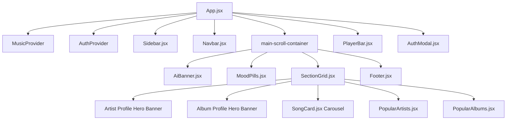

# 🎵 AI Mood Music - Frontend Documentation

A modern, responsive, Spotify-grade music streaming web application built with **React**, **Vite**, **Tailwind CSS**, and the **JioSaavn Music API**.

---

## 📂 1. Project Folder Structure & File Responsibilities

Below is an itemized breakdown of each directory and file designed for beginners and freshers:

```text
AI mood Music/
├── public/                     # Static assets (images, icons)
│   ├── artists/                # Local HD portraits (.jpg) of 12 prominent Indian artists
│   └── vite.svg                # Application favicon
│
├── src/
│   ├── components/             # Reusable modular UI components
│   │   ├── auth/
│   │   │   └── AuthModal.jsx   # Login & signup popup dialog with client-side form validation
│   │   ├── common/
│   │   │   └── Footer.jsx      # Footer containing brand credits, links, and copyright
│   │   ├── layout/
│   │   │   ├── Navbar.jsx      # Top navigation header featuring live debounced search and profile menu
│   │   │   ├── Sidebar.jsx     # Persistent left navigation drawer (Home, Moods, Liked Songs, Playlists)
│   │   │   └── PlayerBar.jsx   # Sticky bottom playback controller (Play, Pause, Seek, Volume, Shuffle)
│   │   └── music/
│   │       ├── AiBanner.jsx    # Dynamic AI prompt banner displaying tailored moods & playlists
│   │       ├── MoodPills.jsx   # Filter pills for instant category switches (Chill, Energy, Sad, Romantic, etc.)
│   │       ├── SectionGrid.jsx # Core dashboard view orchestrator (Tracks, Artist & Album Hero views)
│   │       ├── SongCard.jsx    # Individual song card with artwork, animated equalizer, play, and favorite action
│   │       ├── PopularArtists.jsx # Horizontal artist carousel with verified badges and listener counts
│   │       ├── PopularAlbums.jsx  # Blockbuster albums carousel with category filter pills
│   │       └── ArtistAvatar.jsx   # Singer circular avatar with fallback dynamic gradient initials
│   │
│   ├── context/                # Global state layer powered by React Context API
│   │   ├── MusicContext.jsx    # Audio player engine, song queue, active moods, likes, and search results
│   │   ├── AuthContext.jsx     # Authentication state (Login, Signup, User sessions, Toast alerts)
│   │   ├── context.js          # Raw React.createContext instances
│   │   ├── useMusic.js         # Custom consumption hook -> useMusic()
│   │   └── useAuth.js          # Custom consumption hook -> useAuth()
│   │
│   ├── data/
│   │   └── mockSongs.js        # Curated fallback dataset (Moods, Top Songs, Artists, and Albums)
│   │
│   ├── services/
│   │   ├── musicApi.js         # JioSaavn API client and smart search query resolver
│   │   └── aiService.js        # Natural-language mood prompt parser
│   │
│   ├── App.jsx                 # Root layout assembling Sidebar, Navbar, Main Content, and PlayerBar
│   ├── main.jsx                # Application entry file mounting context providers into the DOM
│   └── index.css               # Global styles, Tailwind directives, and custom scrollbar rules
│
├── package.json                # Project dependencies, scripts, and runtime configuration
└── vite.config.js              # Vite bundler, proxy configuration, and plugin settings
```

---

## 🌲 2. Component Hierarchy



---

## 🔄 3. State Management Architecture

### A. `MusicContext.jsx` (Core Playback Engine)
* **`currentSong`**: Stores the metadata object of the currently playing track.
* **`isPlaying`**: Boolean flag indicating playback status (`true` when playing, `false` when paused).
* **`currentTime` & `duration`**: Numeric counters tracking elapsed and total track duration in seconds for seekbar synchronization.
* **`volume` & `isMuted`**: Audio gain values scaled from `0.0` to `1.0`.
* **`likedSongs`**: Array of user-favorited tracks persisted to browser `localStorage`.
* **`activeMood`**: Active view filter (`'all'`, `'chill'`, `'energy'`, `'romantic'`, `'artist'`, `'album'`, `'liked'`).
* **`selectedArtist`**: Holds selected artist data to display their dedicated discography view.
* **`selectedAlbum`**: Holds selected soundtrack details to populate the complete album tracklist table.
* **`resetToHome()`**: Centralized action to clear active filters and return cleanly to the home view.

### B. `AuthContext.jsx` (User Authentication System)
* **`user`**: Stores logged-in account details (display name, email address, avatar).
* **`openAuthModal(mode)`**: Opens the authentication dialog configured for either login or registration.
* **`login()` & `signup()`**: Handles client-side credential verification, token/session persistence, and validation feedback.

---

## 🎵 4. How Audio Playback Operates Under the Hood

1. **HTML5 Audio Instance**: Initialized once inside `MusicContext.jsx` using `const audioRef = useRef(new Audio())` to prevent redundant audio elements across re-renders.
2. **Audio Lifecycle Listeners**: Configured inside a top-level `useEffect` hook:
   * `'timeupdate'`: Triggers smooth updates to the seekbar and elapsed time counters.
   * `'ended'`: Automatically advances playback to the next track in the queue via `handleNext()`.
   * `'loadedmetadata'`: Synchronizes track duration accurately when a new audio stream buffers.
   * `'play'` and `'pause'`: Keeps all UI play/pause toggles and animated equalizers strictly in sync with hardware state.

---

## 🌐 5. Search Pipeline & API Integration

1. The user types an artist, track, or mood query into the search input inside `Navbar.jsx`.
2. A **350ms debounce handler** buffers input strokes to eliminate wasteful API requests while typing.
3. `musicApi.js` executes queries against the **JioSaavn API** via Vite proxy (`/api/saavn`) to fetch high-bitrate audio streams and HD cover art.
4. If requests fail due to network restrictions or rate limiting, the client seamlessly falls back to local records inside `mockSongs.js` without interrupting the UI.

---

## 🚀 6. Setup & Execution Commands

```bash
# 1. Install dependencies
npm install

# 2. Launch the local Vite development server
npm run dev

# 3. Run ESLint checks
npm run lint

# 4. Generate optimized production distribution bundle
npm run build
```

---

## 💡 7. Technical Highlights & Interview Discussion
* **Architecture**: Modular React 19 architecture with Context API preventing prop drilling across nested components.
* **Responsiveness**: 100% mobile-friendly with slide-over drawers, touch carousels, and adaptive player controls.
* **Performance**: Strict memoization with `useCallback`, `useMemo`, and `useRef` keeping render cycles minimal and audio smooth at 60 FPS.
